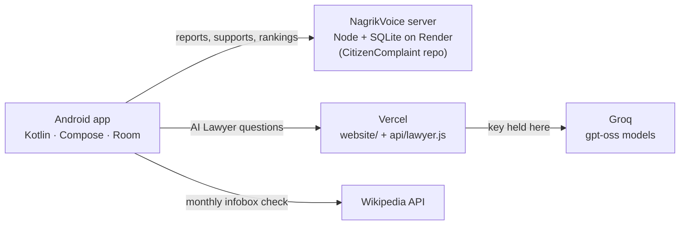

<div align="center">

# Our India

**Who runs your area, and what needs fixing in it.**

An Android app that shows who leads each political party from the national office down to your district, every name linked to its source, together with **NagrikVoice**, a public record of civic problems people report with a photo, and an **AI Lawyer** for Indian law in plain words.

[Website](https://our-india-five.vercel.app/) · [Download the APK](https://github.com/harshoswal1/Our-India/releases/latest/download/OurIndia.apk) · [NagrikVoice server](https://github.com/harshoswal1/CitizenComplaint)

</div>

---

## What's in the app

| Tab | What it does |
|---|---|
| **Home** | A feed of civic reports, newest first. Double-tap a photo to support it, share it, open it on the map, report that it's fixed, or flag it. |
| **Leaders** | 25 parties' organisations. **Orbit** (a unit's head in the middle, its units around them; tap to move in, pinch to zoom), **Chart** (top-down tree), **Map** (states and districts tinted by presence) and **Insights**. |
| **Report** | Photo taken on the spot, location picks the municipal corporation, choose a department, send. Asks you to support an existing report if one is within 100 m. |
| **Issues** | Search and filter every report by city, department and status, plus a ranking of corporations by unresolved, delivered complaints. |
| **You** | Sign in, your reports and supports, and notes on where the data comes from. |
| **AI Lawyer** | The violet button on every tab. Ask a legal question, draft a notice, complaint or RTI application, look up old IPC sections under the new BNS, and find your rights and helplines. |

First launch shows a short tour and asks for location; the tour can be replayed from **You**.

## How the data is kept honest

- **Party posts.** Every named holder in the bundled data carries the published report it was checked against (party sites, Wikipedia, national and regional news). A post we couldn't confirm says *Not yet recorded*, never a guess.
- **Monthly updates.** National heads of 23 parties and BJP/INC state presidents are re-checked against Wikipedia once a month (WorkManager). Only a **change** on Wikipedia replaces the bundled name, shown straight away and marked *not yet verified*, with a link. A page that merely disagrees, or redirects elsewhere, is ignored.
- **Civic reports.** Delivery of complaint emails to corporations is still **simulated** on the NagrikVoice server, and the app labels those reports *demo delivery*.
- **AI Lawyer.** Answers come from an open model through our server and can be wrong; the app says so and points to free legal aid (NALSA 15100).

## How it fits together



## Repository layout

```
android/            The app (single :app module)
  app/src/main/java/com/ourindia/app/
    ui/home         Feed
    ui/partystructure  Leaders: orbit, chart, map, insights, bundled party data
    ui/civic        Report, Issues, issue detail, sign-in (NagrikVoice)
    ui/lawyer       AI Lawyer
    data/leaders    Monthly Wikipedia check (Room table leader_updates)
    data/civic      NagrikVoice API client, municipal department directory
    data/lawyer     AI Lawyer client and the IPC → BNS / rights data
  debug.keystore    Shared debug signing key (see below)
api/lawyer.js       Vercel function: Groq proxy for the AI Lawyer
website/            The site served by Vercel
tests/              Node tests for the proxy
backend/            Python ingestion worker (GitHub Actions → Supabase); not yet read by the app
Data/               Source GeoJSON boundaries
```

## Build and run

Requirements: JDK 17 and the Android SDK (platform 35).

```bash
cd android
./gradlew :app:assembleDebug        # APK: app/build/outputs/apk/debug/app-debug.apk
./gradlew testDebugUnitTest         # unit + Robolectric UI tests
```

Optional settings in `android/local.properties`:

| Key | Default | Use |
|---|---|---|
| `LAWYER_API_URL` | `https://our-india-five.vercel.app/api/lawyer` | Point the AI Lawyer at another deploy |
| `LAWYER_APP_TOKEN` | empty | Must match `LAWYER_APP_TOKEN` on Vercel if you set one |
| `CIVIC_API_URL` | `https://citizencomplaint.onrender.com/api/v1/` | NagrikVoice server |

No secret belongs in the app. The Groq key lives only on Vercel.

Proxy tests: `node --test tests/lawyer-proxy.test.js`

## Deploy

**Website and AI Lawyer (Vercel).** Import this repo with **Root Directory empty** and **Framework Preset "Other"**; `vercel.json` serves `website/` and runs `api/lawyer.js`. Add the environment variable `GROQ_API_KEY` (and optionally `LAWYER_APP_TOKEN`), then redeploy.

**APK.** Every push to `main` that touches `android/` runs `.github/workflows/android-apk.yml`, which builds the app and publishes it as the latest GitHub release under the name `OurIndia.apk`. The website's download button always points there. Builds are signed with the shared `android/debug.keystore`, so a new download installs over an older one.

## Known limitations

- NagrikVoice email delivery is simulated, and the server runs on Render's free tier: it sleeps when idle (first load can take a minute) and its SQLite file is wiped on restart.
- 48 of the 73 parties in the catalogue have no organisation data yet; they show as not mapped.
- District-level posts exist for some states only, and they are not covered by the monthly Wikipedia check.
- These are debug builds, not Play Store releases.

## Team

Tejas Karpe ([@Tejas9406](https://github.com/Tejas9406)) · Prasan Phadatare ([@PixelPewds](https://github.com/PixelPewds)) · Harsh Oswal ([@harshoswal1](https://github.com/harshoswal1)) · Shivam Patil

Our India is an independent project, not affiliated with any party or government body. Spotted a wrong name? Open an issue with a link to a source.
